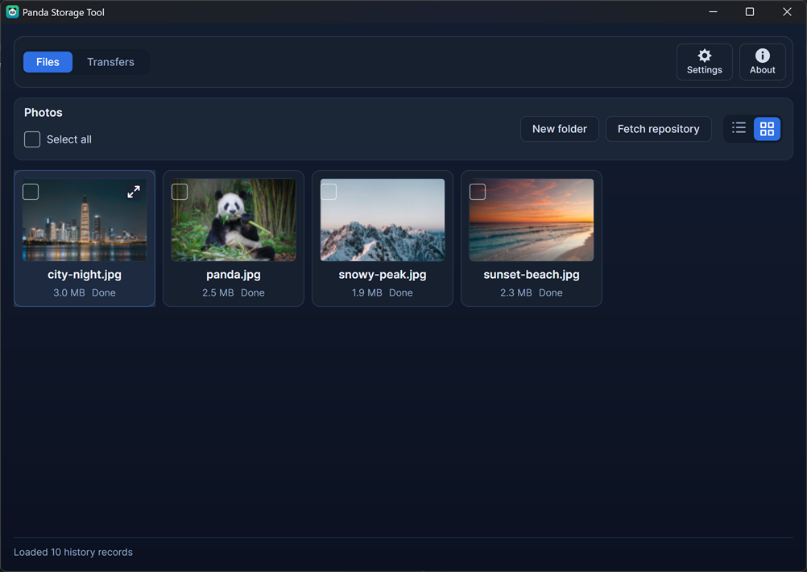
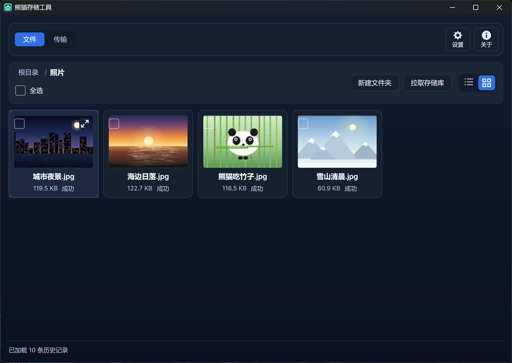
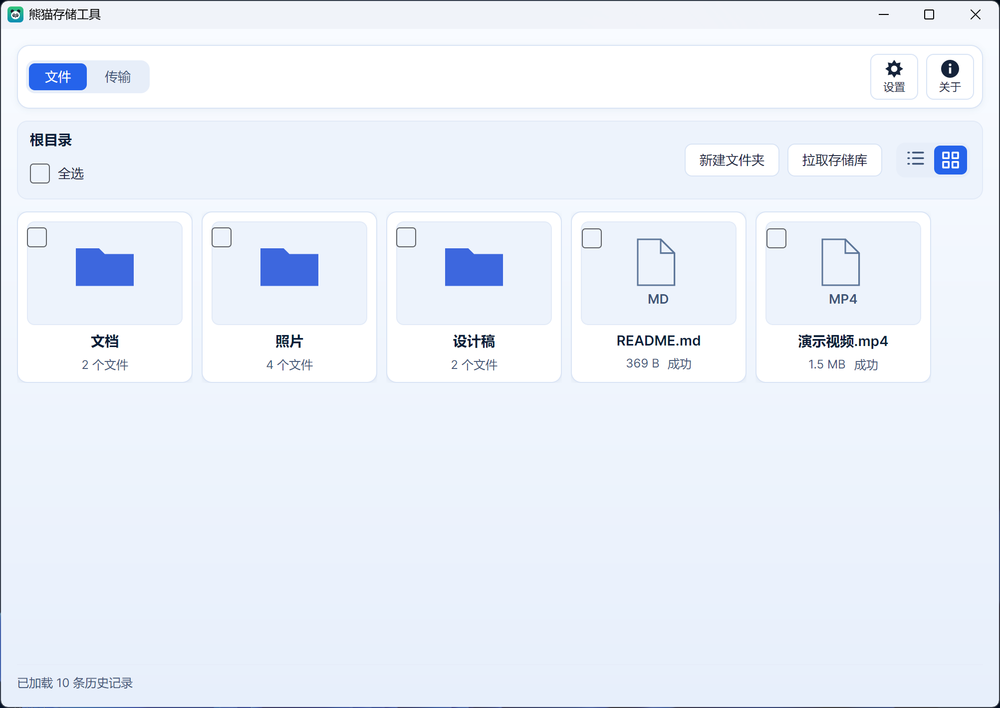
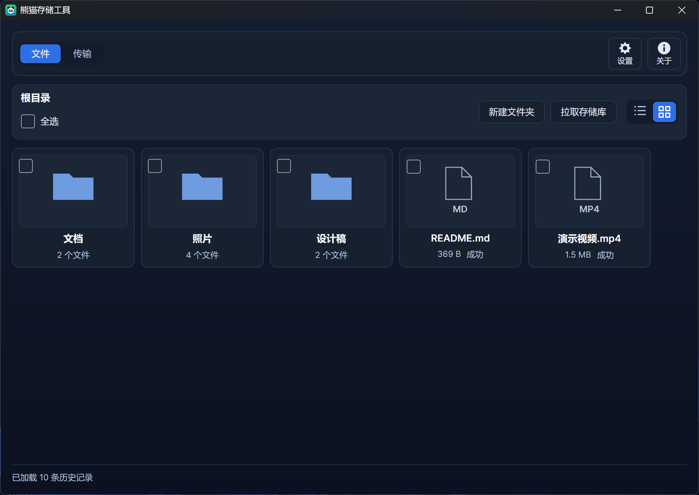
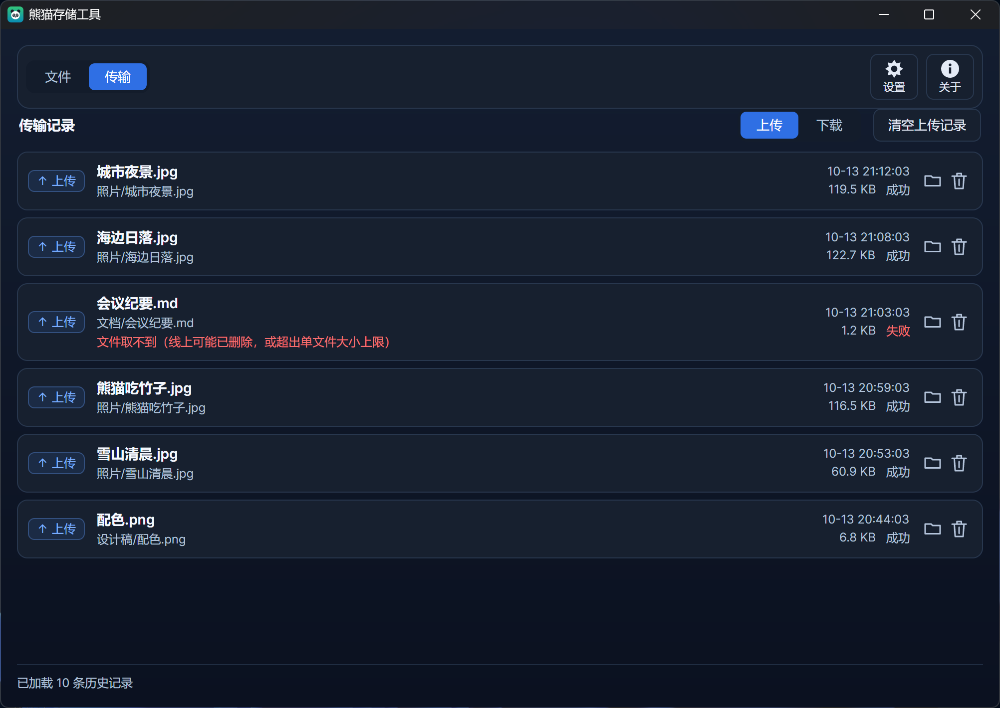
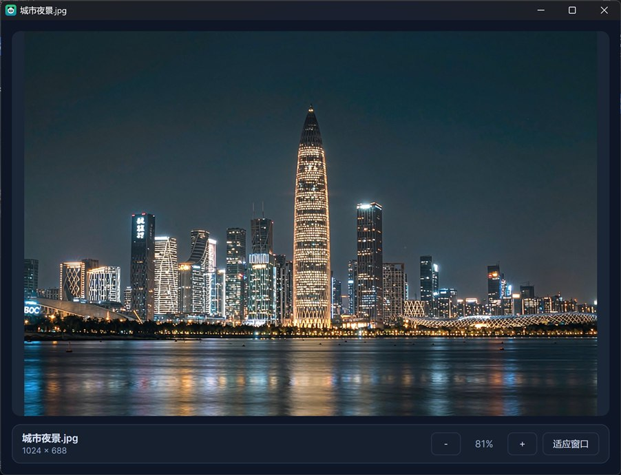
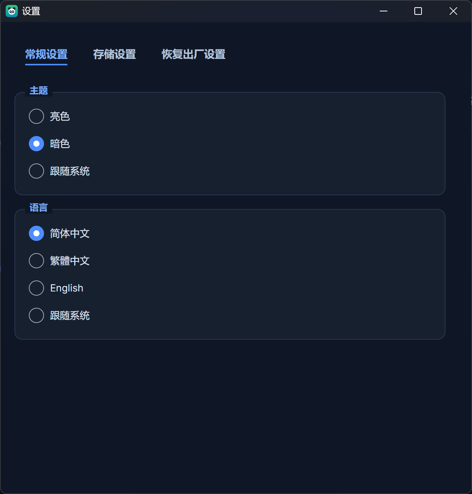
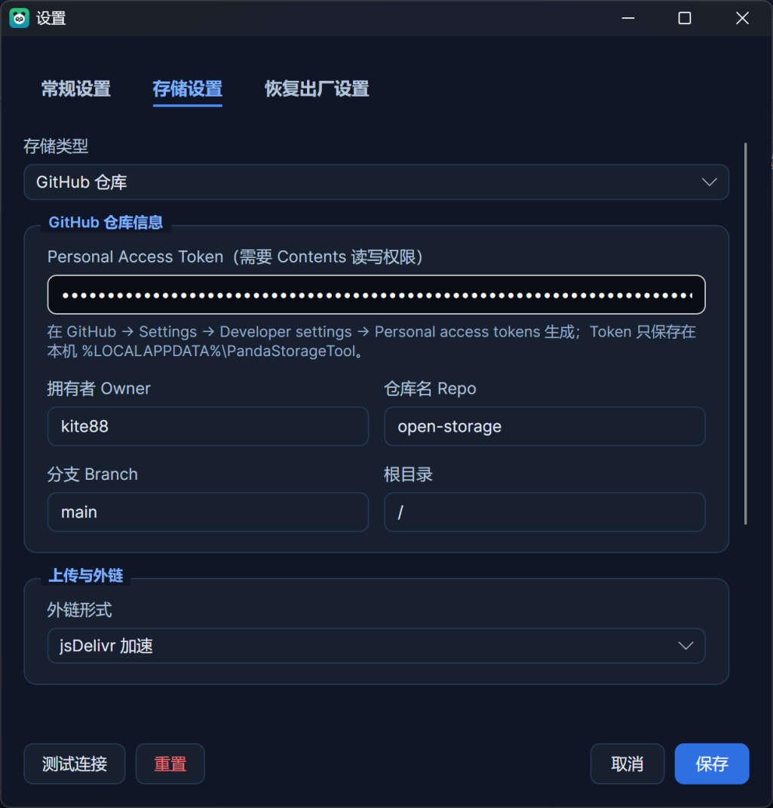
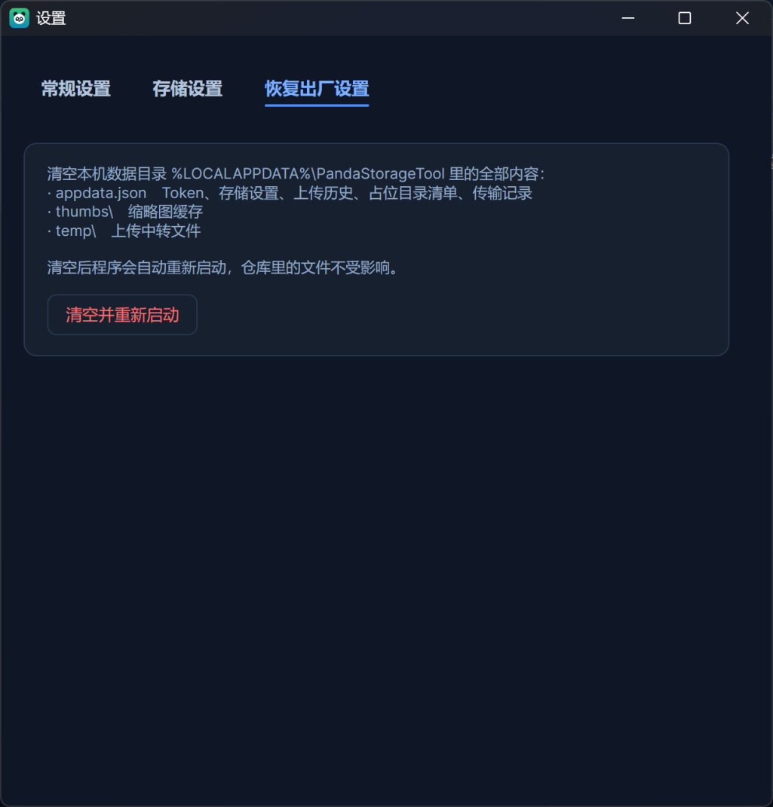
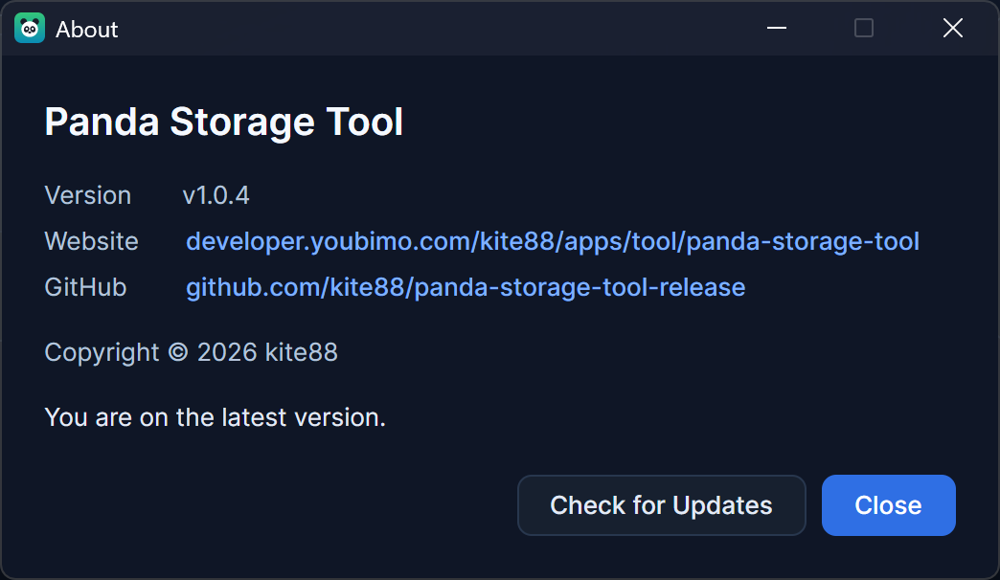

[简体中文](README.md) | English

<p align="center">
  
</p>

# Panda Storage Tool · use a GitHub repository as cloud storage

[](https://github.com/kite88/panda-storage-tool-release/releases/latest)

A cross-platform desktop app (Avalonia UI / .NET 10) that turns a **GitHub repository into a cloud drive**:
drop files or whole folders onto the window to upload them, then browse level by level, download, rename and
delete in batches like a file manager — and copy shareable links (raw / jsDelivr) as you go.

Any file type works: images, documents, archives, audio & video, code. The only visual difference is that
images get thumbnails while everything else gets a type badge (extension + document outline).
`.gitkeep` is the single special case: it is the placeholder that keeps empty folders alive in the repository,
so it never shows up in the list.

Runs on Windows / macOS / Linux with English and Chinese UI plus light & dark themes. Release packages are
**self-contained single files — no .NET runtime needed**, unzip and run.

## Screenshots

**Files (English): folders and files are first-class, and each folder shows how many files it holds**



**Photo grid (dark): images get thumbnails, and a zoom badge appears in the corner on hover**



**Light theme**



**Folders & files, dark theme**



**Transfer log: every upload and download is recorded, failures come with a reason**



**Click a thumbnail to view it large: zoom, fit to window, Ctrl + wheel, `Esc` to close**



**General: theme and language, applied as soon as you pick them**



**Storage settings: pick the repository, branch and root directory, then "Test connection"**



**Factory reset: wipes the local data folder and restarts the app — repository files are untouched**



**About: version, website and GitHub links, plus a one-click update check**



## Features

- **Drag & drop / paste upload**: drop files or folders onto the list to upload them into the current folder;
  `Ctrl + V` uploads a bitmap from the clipboard (screenshots, images copied from a web page) or files copied
  in your file manager. The context menu also offers "Upload files / Upload folder / Paste".
- **Upload a whole folder**: the local folder tree is recreated under the current folder, every level gets a
  `.gitkeep`, and sub-folders that contain no file at all are created too — so the structure stays intact
  in the repository.
- **Cloud-drive browsing**: double-click to enter a folder, breadcrumbs to jump back; each folder shows the
  number of files it contains (including nested ones); empty folders kept alive by `.gitkeep` are listed as well
  (count 0). The drive root is the "root directory" configured in settings (empty = the whole repository).
- **Download**: right-click a file → "Download to…", right-click a folder → "Download to folder…" (the folder
  itself and all nested folders are recreated), or tick several items and download them in one go — files land
  under their path relative to the current folder, so identical names in different folders never collide.
- **Transfer log**: every upload and download is recorded (direction, name and repository path, size, time,
  success or failure) with an upload-only / download-only filter, a "locate" button per row and a way to drop
  a single entry.
- **View images large**: click a thumbnail to open the preview window; zoom with `＋ / －`, fit to window or
  `Ctrl + wheel`, close with `Esc`.
- **Shareable links**: right-click → "Copy" gives you URL / Markdown / HTML (images as ``, other files
  as `[](...)`); the link format is `raw.githubusercontent.com`, jsDelivr or your own template.
- **Rename & delete**: right-click or press `F2` to rename (the file keeps its content, links and references
  follow); delete single files, whole folders, or a multi-selection with live progress and a confirmation.
- **Name conflicts**: auto-rename / overwrite / fail, your choice in the storage settings.
- **Reset storage settings**: the "Reset" button at the bottom of the storage tab clears the token, owner,
  repository and root directory (link format, name-conflict mode and commit message go back to their defaults);
  your local file list and transfer log are kept, and the reset takes effect immediately.
- **Factory reset**: the third tab wipes the local data folder (settings, thumbnail cache, upload staging)
  and restarts the app automatically, as if freshly installed — nothing in the repository is touched.
- **Theme & language**: light / dark / follow system, and English / Simplified Chinese / Traditional Chinese /
  follow system — applied immediately and saved.
- **Update check**: "About" can query the latest release on demand, and the app also checks silently once a day.
  Only packages built for your platform count, so releases for other platforms never trigger a false update.
  The website and GitHub links shown in "About" are fetched from `appinfo.json` in the release repository when
  the window opens, so changing them never needs a new build.
- **Shortcuts**: `Ctrl + V` upload clipboard, `Delete` delete selection, `F2` rename current item.

## Download & run

Grab the package for your platform from
[Releases](https://github.com/kite88/panda-storage-tool-release/releases/latest):

| File | Platform |
| --- | --- |
| `PandaStorageTool-win-x64-<version>.zip` | Windows 64-bit (Intel / AMD) |
| `PandaStorageTool-win-x86-<version>.zip` | Windows 32-bit |
| `PandaStorageTool-win-arm64-<version>.zip` | Windows on ARM |
| `PandaStorageTool-linux-x64-<version>.tar.gz` | Linux 64-bit (Intel / AMD) |
| `PandaStorageTool-linux-arm64-<version>.tar.gz` | Linux ARM64 |
| `PandaStorageTool-osx-x64-<version>.tar.gz` | macOS (Intel) |
| `PandaStorageTool-osx-arm64-<version>.tar.gz` | macOS (Apple silicon) |

- Every package is a **self-contained single file — no .NET runtime required**. On Windows unzip and run
  `PandaStorageTool.exe`; on Linux / macOS run `chmod +x PandaStorageTool` first.
- On Windows the first launch may trigger SmartScreen ("Windows protected your PC") because the binaries are
  not code-signed — that is expected: click "More info" → "Run anyway", or right-click `PandaStorageTool.exe` →
  Properties → tick "Unblock", or run `Unblock-File .\PandaStorageTool.exe` in PowerShell.
- On macOS the first launch may be blocked by Gatekeeper: allow it under
  System Settings → Privacy & Security.
- `checksums.txt` holds the SHA256 checksums of all packages (`sha256sum -c checksums.txt`).
- Nothing to uninstall: no registry entries, no services — the only data on disk is the config folder below.

## Before you start

1. **Prepare a repository to store files in** — a fresh empty one or an existing one. A **public** repository is
   recommended: only then are raw / jsDelivr links readable by anyone (a private repository accepts uploads but
   others cannot open the links; the app warns you about this when you test the connection).
2. **Create a Personal Access Token**: GitHub → Settings → Developer settings → Personal access tokens with
   read & write access to repository contents (classic: `repo` or `public_repo`; fine-grained:
   `Contents: Read and write`).
3. Open the app → "Settings" → "Storage": choose the **storage type** "GitHub repository", fill in the token,
   owner, repository and branch, hit "Test connection" and save. Saving runs the connection test again first:
   if it fails nothing is written and the window stays open, so you can fix the values and save again; a
   successful save then syncs with the repository as the source of truth.
4. The **root directory** decides where the drive starts: empty means the whole repository is the drive;
   set it to something like `files` or `assets` to narrow the scope so README, `.github/` and friends stay
   out of the list.

The token is stored on your machine only (see below) and is never sent anywhere except GitHub.

## How to use

1. **Upload**: drop files onto the list (or press `Ctrl + V`, or right-click → "Upload files") — they go into
   the **current folder**. Dropping a folder uploads it recursively, keeping its structure. Multiple files are
   committed one by one with a "2/5 uploading" status; failed ones can be retried from the context menu.
2. **Browse**: double-click a folder to enter it, use the breadcrumb to jump back; the top-right switch toggles
   between **grid** (thumbnail cards) and **list**, and your choice is remembered.
3. **Select & batch**: left-click selects one card, `Ctrl` adds, `Shift` selects a range, dragging on empty
   space marquee-selects, a plain click on empty space clears everything. With a selection, "Delete selected"
   and "Download selected" appear in the toolbar and in the context menu.
4. **Download**: right-click → "Download to…" for a file, "Download to folder…" for a folder, or "Download
   selected" for a batch.
5. **Copy links**: right-click a card → "Copy" → URL / Markdown / HTML; a toast confirms it.
6. **Transfer log**: switch to the "Transfers" page to review every upload and download, filter by direction,
   and clear just the log (never the files).
7. **Settings**: the "Settings" button in the top-right toolbar → "General" for theme and language (applied
   immediately); "Storage" for the token, repository and root directory ("Reset" clears them for a fresh start);
   the third tab, "Factory reset", wipes the local data and restarts the app — repository files are untouched.

## Where the data lives

```
%LOCALAPPDATA%\PandaStorageTool\
├─ appdata.json   token, storage settings, upload history, placeholder folders, transfers
├─ appinfo.json   cached website / GitHub links shown in "About" (fetched when the window opens)
├─ thumbs\        thumbnail cache (named by content, shared between records)
└─ temp\          temporary staging for uploads
```

On macOS / Linux it lives in the corresponding application-data directory. You do not have to delete it by
hand: "Settings → Factory reset" clears the folder and restarts the app (the token goes with it). Closing the
app and deleting the folder yourself does the same thing.

## Known limitations

- The GitHub Contents API recommends files ≤ 100 MB; use Git LFS or the Git Data API for anything larger.
- Non-image files only get a type badge, not a content preview — use "Open link" to view them.
- Uploading a folder commits one file at a time (plus one placeholder commit per empty folder), so large
  folders are slow and can hit GitHub's API rate limit (5000 requests per hour).
- Renaming (including folders) is "read the new path + delete the old one", one commit per file; a failure in
  the middle can leave the move half-done — the "Refresh" command realigns the list with the repository.
- jsDelivr caches files, so a link may stay reachable for a short while after delete or overwrite.
- Sync and "Refresh" use the Git Trees API: GitHub truncates the answer for huge repositories, and the "root
  directory" filter is applied client-side.
- Empty folders are tracked locally: folders deleted elsewhere (web UI, command line) disappear only after a
  "Refresh" or "Fetch repository".
- The update check is an **anonymous** GitHub API call (60 requests per hour per IP); when rate-limited or
  offline it just shows "check failed" without affecting anything else. It only looks at *published* releases
  (prereleases and drafts do not count); with none at all it says "no release has been published yet"
  instead, which is not an error.
- The website and GitHub links in "About" come from `appinfo.json` in the release repository (the GitHub raw
  URL and jsDelivr are queried in parallel, whichever answers first wins); if both fail the cached copy is
  used, and with no cache at all those two rows are simply hidden.
- "Factory reset" deletes local files, so a second instance holding them can make it fail: in that case the
  app does **not** restart, it just asks you to close the other instance and try again; if the new instance
  cannot be started you are told to reopen the app by hand (the data is already gone).
