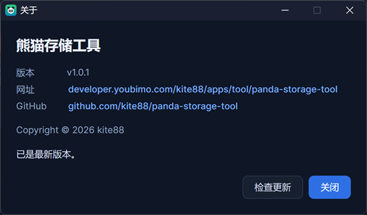

简体中文 | [English](README.en.md)

# 熊猫存储工具 · 把 GitHub 仓库当网盘的桌面工具

[](https://github.com/kite88/panda-storage-tool-release/releases/latest)

一个跨平台桌面工具（Avalonia UI / .NET 10），把 **GitHub 仓库当成网盘**：文件或整个文件夹拖进窗口就完成上传，
之后像文件管理器那样逐级浏览、下载、重命名、批量删除，并顺手拿到可以直接分享的外链（raw / jsDelivr）。

文件类型不限——图片、文档、压缩包、音视频、代码都能放进来管理；区别只在显示上：图片给缩略图，
其它文件给「扩展名 + 文档轮廓」的类型徽标。唯一被特殊对待的是 `.gitkeep`：它是程序用来撑住空目录的
占位文件，只在仓库里存在，不出现在列表里。

Windows / macOS / Linux 三平台，中英双语界面与亮暗主题；发布包是**自包含单文件，免装 .NET 运行时**，解压即用。

## 截图

**文件（暗色）：文件夹与文件一视同仁，子目录显示其下的文件数量**


**图片网格（暗色）：图片给缩略图，鼠标移上去右上有「放大」角标**


**亮色主题**


**English 界面**


**传输记录：上传 / 下载留痕，失败的还会写明原因**


**点缩略图看大图：缩放、适应窗口、Ctrl + 滚轮，`Esc` 关闭**


**常规设置：主题与语言，选中即时生效并写入配置**


**存储设置：选好仓库、分支与根目录，点「测试连接」确认无误再保存（右下是「保存」，左下是「测试连接 / 重置」）**


**恢复出厂设置：清空本机数据后程序自动重启，仓库里的文件不动**


**关于窗口：版本号、官网与 GitHub 链接，还能一键检查更新**



## 功能特性

- **拖拽 / 粘贴上传**：把文件或文件夹拖到列表区域即上传到当前目录；`Ctrl + V` 能把剪贴板里的位图
  （截图、网页上复制的图片）或资源管理器里复制的文件直接传上去；视图区右键菜单里也有「上传文件 / 上传文件夹 / 粘贴」。
- **上传整个文件夹**：按本地原有的子目录结构递归上传到当前目录下的同名文件夹，
  每一级都会补 `.gitkeep`，一个文件都没有的空子目录也会被建出来（目录结构在仓库里保持完整）。
- **目录浏览（云盘式）**：双击进子目录、面包屑跳回任意一级；子目录显示其下（含各级子目录）的文件数量；
  只有 `.gitkeep` 的空目录同样显示（计数为 0）。根目录就是存储设置里配的那个「根目录」，留空即整个仓库。
- **下载**：右键单个文件「下载到本地…」；右键子目录「下载到文件夹…」会把该目录本身连同各级子目录一起还原；
  勾选多个条目后一次可批量下载（落盘按「相对当前目录的路径」，不同目录下的同名文件不会互相覆盖）。
- **传输记录页**：上传 / 下载逐条留痕（方向、文件名与仓库路径、大小、时间、成功或失败），
  可按方向只看上传 / 只看下载；每行能「定位」（下载记录打开落盘位置，上传记录跳到它所在目录）或删掉这一条。
- **看大图**：点图片卡片的缩略图弹出预览窗口，支持 `＋ / －`、适应窗口、`Ctrl + 滚轮`缩放，`Esc` 关闭。
- **外链随手复制**：右键「复制」子菜单里有 URL / Markdown / HTML，图片给 ``、其它文件给 `[](...)`，
  外链形式可选 `raw.githubusercontent.com`、jsDelivr 加速或自定义模板。
- **重命名与删除**：右键或按 `F2` 改名（文件只换名字不动内容，外链与引用文本一起更新）；
  删除单个文件 / 整个子目录，或勾选一片后批量删除（删除前有确认，删除过程能实时看到进度）。
- **重名策略**：自动重命名 / 覆盖 / 报错，在存储设置里选。
- **重置存储设置**：存储设置底部的「重置」一键清空 Token、拥有者、仓库名与根目录
  （外链形式、重名处理、提交信息回到默认值）；本机的文件列表与传输记录保留，确认后立即生效。
- **恢复出厂设置**：设置里第三个选项卡把本机数据目录整个清空（配置、缩略图缓存、上传中转文件）
  并自动重新启动程序，等于刚装好——仓库里的文件一个都不动。
- **主题与语言**：亮色 / 暗色 / 跟随系统；简体中文 / 繁體中文 / English / 跟随系统，选中即时生效并写入配置。
- **检查更新**：在「关于」里可以手动查一次最新版本，程序启动时也会静默查一次（一天至多一次）；
  比对时只认与当前运行平台匹配的安装包，只发了别的平台的包不会误报。
  「关于」里的官网与 GitHub 地址是打开窗口时从发版仓库的 `appinfo.json` 现取的，以后改地址不必再发一个新版本。
- **快捷键**：`Ctrl + V` 上传剪贴板内容、`Delete` 删除勾选项、`F2` 重命名当前条目。

## 下载与运行

从 [Releases](https://github.com/kite88/panda-storage-tool-release/releases/latest) 下载对应平台的包：

| 文件 | 适用 |
| --- | --- |
| `PandaStorageTool-win-x64-<版本>.zip` | Windows 64 位（Intel / AMD，最常见） |
| `PandaStorageTool-win-x86-<版本>.zip` | Windows 32 位 |
| `PandaStorageTool-win-arm64-<版本>.zip` | Windows on ARM（如骁龙笔记本） |
| `PandaStorageTool-linux-x64-<版本>.tar.gz` | Linux 64 位（Intel / AMD） |
| `PandaStorageTool-linux-arm64-<版本>.tar.gz` | Linux ARM64 |
| `PandaStorageTool-osx-x64-<版本>.tar.gz` | macOS（Intel） |
| `PandaStorageTool-osx-arm64-<版本>.tar.gz` | macOS（Apple 芯片） |

- 都是**自包含单文件包，免装 .NET 运行时**：Windows 解压得到 `PandaStorageTool.exe` 双击即用；
  Linux / macOS 解压后 `chmod +x PandaStorageTool` 再运行。
- macOS 首次打开若被系统拦下，去「系统设置 → 隐私与安全性」放行即可。
- `checksums.txt` 是上面所有包的 SHA256 校验和（`sha256sum -c checksums.txt`）。
- 卸载即删：程序不写注册表、不装服务，唯一的落盘数据是下面说的配置目录。

## 使用前准备

1. **准备一个用来存文件的仓库**：可以是新建的空仓库，也可以复用已有仓库。
   **建议用公开仓库**——只有公开仓库才能让 raw / jsDelivr 外链被匿名访问；私有仓库能上传，但外链别人打不开
   （程序在「测试连接」时会给出对应的橙色提醒）。
2. **生成一个 Personal Access Token**：GitHub → Settings → Developer settings → Personal access tokens，
   勾选仓库内容的读写权限（classic 选 `repo` 或 `public_repo`；fine-grained 选 `Contents: Read and write`）。
3. 打开程序 →「设置」→「存储设置」：**存储类型**选「GitHub 仓库」，填 Token、拥有者 Owner、仓库名 Repo、
   分支 Branch；点「测试连接」确认无误后保存。**保存时程序会先自动测一次连接**：连不上就不写配置、
   也不关窗口，改完可以直接再点保存；保存成功后会自动以仓库内容为准同步一次。
4. **根目录**决定云盘从仓库的哪一层开始：默认为空，即整个仓库都是云盘范围；填 `files`、`assets`
   之类的目录名则把范围收窄到该目录，仓库里的 README、`.github/` 等就不会出现在列表里。

Token 只保存在本机（见下一节），不会发给除 GitHub 之外的任何地方。

## 使用说明

1. **上传**：把文件拖到列表区域（或按 `Ctrl + V` 粘贴、右键「上传文件」）→ 上传到**当前目录**；
   拖文件夹则按原有目录结构递归上传。多文件会逐个提交，状态栏显示「上传中 2/5」，失败的可右键重试。
2. **浏览**：双击子目录进入，点面包屑跳回任意一级；右上角可在**网格**（缩略图卡片）与**列表**
   之间切换，选择会被记住。
3. **选择与批量操作**：左击卡片＝单选，`Ctrl` 加选、`Shift` 连选，空白处拖框多选，空白处单击全部取消；
   勾选后目录栏会出现「删除选中」「下载选中」，右键菜单里也有。
4. **下载**：右键文件「下载到本地…」，右键子目录「下载到文件夹…」，或勾选一片后「下载选中」。
5. **拿外链**：右键卡片 →「复制」→ URL / Markdown / HTML，复制后弹一句气泡提示。
6. **传输记录**：切到「传输」页看每一次上传与下载；顶部可按方向筛选，右上角「清空上传记录 /
   清空下载记录」只清留痕，不动仓库里的文件。
7. **设置**：右上角「设置」图标按钮 →「常规设置」里切换主题与语言（即点即生效）；
   「存储设置」里改 Token、仓库、根目录（点「重置」可清空重填）；
   想彻底重来就用第三个选项卡「恢复出厂设置」——清空本机数据后程序会自己重启，仓库里的文件不动。

## 数据放在哪

```
%LOCALAPPDATA%\PandaStorageTool\
├─ appdata.json   Token、存储设置、上传历史、占位目录清单、传输记录
├─ appinfo.json   「关于」窗口的官网 / GitHub 地址缓存（打开窗口时从发版仓库现取）
├─ thumbs\        缩略图缓存（按内容命名，可能被多条记录共用）
└─ temp\          上传中转
```

macOS / Linux 位于对应的应用数据目录下。需要重置时不必手动删目录：程序里「设置 → 恢复出厂设置」
会清空这个目录并自动重启（Token 也一并清除）；当然，关掉程序手动删掉它效果一样。

## 已知限制

- GitHub Contents API 单文件建议 ≤ 100 MB，超大文件请改用 Git LFS 或 Git Data API。
- 非图片文件只显示类型徽标，不做内容预览；要看内容请用右键菜单里的「打开外链」。
- 上传文件夹是「一个文件一次提交」（外加每个空目录一次占位提交），文件很多时比较慢，
  也容易撞到 GitHub 的 API 速率限制（每小时 5000 次请求）。
- 重命名（含子目录改名）是「读到新路径 + 删掉旧路径」，每个文件一次提交；中途失败可能只搬了一半，
  右键菜单里的「刷新」会按仓库内容重新对齐列表。
- jsDelivr 有缓存，删除或覆盖同名文件后外链可能短暂仍可访问。
- 同步与「刷新」走 Git Trees API：仓库文件极多时 GitHub 会截断返回结果，
  且「根目录」是客户端过滤（一次请求拿全树后按目录筛）。
- 空目录的显示以本地记录为准：在别处（网页 / 命令行）删掉的空目录，要等「刷新」或「拉取存储库」之后才会消失。
- 更新检查是**匿名**请求 GitHub 接口（同 IP 每小时 60 次），被限流或断网时只会显示一句「检查更新失败」，
  不影响其它功能。
- 「关于」里的官网与 GitHub 地址取自发版仓库的 `appinfo.json`（GitHub 直链与 jsDelivr 两条路一起取，
  谁先拿到有效内容用谁）；两条都取不到就用本机的旧缓存，连缓存都没有时这两行干脆不显示。
- 「恢复出厂设置」删的是本机文件，被另一个实例占着就可能删不干净：此时程序**不会重启**，
  只提示关掉其它实例再试；新实例起不来时也会提示手动重开（数据已经清掉了）。
